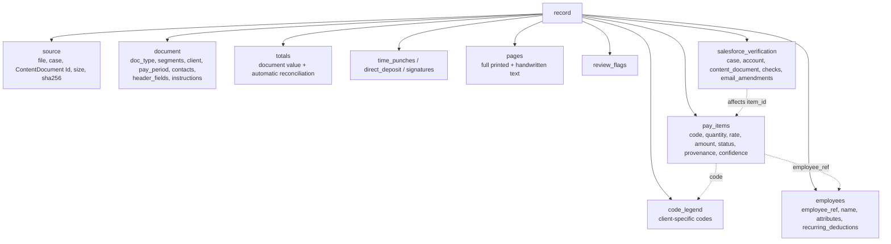

# Payroll Extraction Format v2 (JSON / JSONL)

| | |
|---|---|
| Schema | `payroll_extraction.schema.json` (JSON Schema draft 2020-12, `schema_version` = "2.0") |
| Dataset | `../payroll_extractions.jsonl` — one record per source PDF per line |
| Per-record files | `../records/<record_id>.json` (pretty-printed copies of each line) |
| Import mapping config | `import_column_map.json` |
| Replaces | v1 Excel template (`Payroll_Attachment_Extraction_Template.xlsx`) and v1 per-document JSON (`pipeline/json/`) |

## 1. Record structure

## 2. v1 Excel tab to v2 field mapping

| v1 tab | v2 location | Change |
|---|---|---|
| Documents | `source`, `document` | Header values carry `source`, `page`, `confidence`; dates stored ISO with the raw text kept |
| Employees | `employees[]` | Fixed columns replaced by an open `attributes` object; stable `employee_ref` |
| Pay_Lines | `pay_items[]` | Adds `status`, `quantity.unit`, structured `provenance`, `confidence`, `review_reasons` |
| Permanent_Deductions | `employees[].recurring_deductions[]` | Nested under the employee; `change_requested` captures handwritten changes |
| Time_Punches | `time_punches[]` | Any number of in/out `segments` per day |
| Direct_Deposit | `direct_deposit[]` | Any number of `accounts`; struck-through accounts flagged |
| Report_Totals | `totals[]` | Adds `scope`, `code`, `measure`; `extracted_sum`, `difference`, `reconciles` computed by `src/pipeline/stages/reconcile.py` |
| Signatures | `signatures[]` | Unchanged |
| Page_Transcriptions | `pages[]` | Unchanged |
| Review_Flags | `review_flags[]` | Adds machine-readable `code`, `severity`, `refs` |
| Salesforce_Verification | `salesforce_verification` | Per-record; adds `email_amendments` linked to `pay_items` |
| (none) | `code_legend[]` | New: the client's printed code legend |
| (none) | `document.segments[]` | New: page ranges for mixed PDFs (cover sheet + timesheet, second client) |
| (none) | `document.instructions[]` | New: free-text instructions that are not single pay items |

## 3. Improvements over v1

1. **Pay item status.** `submitted`, `printed_default`, `struck_through`, `superseded`, `excluded`, `added_from_email`. The batch-1 review found printed recurring amounts (Westside code 28) being counted as inputs; status separates pre-printed defaults from client entries, and lets email amendments change an item without deleting it.
2. **Client code legend per record.** Batch 2 showed codes 1, 2, 19 and 23-28 carry the same description in all or all but one of 30 client legends, while 3-6, 11-15, 21, 22 and 30+ vary (code 30 = TRAINING, SNOW, HEALTH OPT, CLEANING or MED REIMB depending on client). Storing the legend makes code meaning resolvable per record.
3. **Open attribute bags.** `employees[].attributes` and `document.header_fields` accept any printed label, so new form variants do not need a schema change.
4. **Provenance and confidence on every value.** Page, location, raw text, source (handwritten / printed / typed / email), and confidence.
5. **Automatic reconciliation.** Totals declare `scope`, `code`, `measure`; the finalizer sums matching pay items and raises `TOTAL_MISMATCH` flags.
6. **Salesforce verification and email amendments inside the record.** Each amendment lists the `item_id`s it affects.
7. **Template-agnostic.** Mapping to an import layout is configuration (`import_column_map.json`) applied by `src/pipeline/exporters/earning_by_column.py`, not part of extraction.

## 4. Pipeline commands

The batch pipeline in `src/pipeline/` replaces the one-off scripts that used to live beside this schema. See `src/pipeline/README.md` for the commands. Validation runs inside the pipeline (`validate` stage) and the review app reads the v2 records it writes.

`jsonschema` 4.18 or later is required for draft 2020-12 validation.

## 5. Import column mapping

`import_column_map.json` resolves each pay item code in this order: client override, default code map, keyword match on the record's own legend description. Items whose status is not in the status policy, non-earning items, and unresolved codes are written to `exports/earning_by_column_exceptions.csv` for review. Only the Default Earning by Column Import layout is configured (columns observed in client attachments); the other two templates remain placeholders.

## 6. Schema revisions

| Date | Change (backward compatible, `schema_version` stays "2.0") |
|---|---|
| 2026-10-02 | Optional `totals[].column` (report column the total sits under) so amount totals reconcile by item type |
| 2026-10-02 | Optional `extraction.review_status` (auto_ok / needs_review / failed) and `extraction.review_reasons` written by the pipeline's validate stage |
| 2026-10-02 | `salesforce_verification.case.id`, `account.id`, `account.name`, `queried_at` accept null |

The pipeline package carries the same file as `src/pipeline/schemas/record_v2.schema.json`; keep the two identical.

## 7. Sensitive fields

`direct_deposit[].ssn`, account and routing numbers, and some `pages[].printed_text` (roster notes, W-4 pages) hold PII as written on the source. Restrict access to the JSONL and records folder accordingly.
